<!-- Nimal Prince · GitHub profile README
     The cartoon cards are SVGs in ./assets, generated by tools/build.py.
     The snake animation needs .github/workflows/snake.yml in this repo. -->

 

<picture>
  <source media="(prefers-color-scheme: dark)" srcset="https://raw.githubusercontent.com/Nimal-dev/Nimal-dev/output/github-contribution-grid-snake-dark.svg" />
  <source media="(prefers-color-scheme: light)" srcset="https://raw.githubusercontent.com/Nimal-dev/Nimal-dev/output/github-contribution-grid-snake.svg" />
  
</picture>

 

  

<table border="0" width="100%">
<tr>
<td width="50%" valign="top"></td>
<td width="50%" valign="top"></td>
</tr>
<tr>
<td width="50%" valign="top"></td>
<td width="50%" valign="top"></td>
</tr>
<tr>
<td width="50%" valign="top"></td>
<td width="50%" valign="top"></td>
</tr>
</table>

 

**Mobile** 

**Web** 

**Backend and data** 

**Tools** 

 

 

  

